# Архитектура и потоки данных

## Из чего состоит система

```mermaid
flowchart LR
  visitor([Посетитель]) --> nginx
  staff([Сотрудник]) --> nginx
  subgraph VPS [VPS, Docker Compose]
    nginx[nginx<br/>TLS, домены]
    web[web<br/>сайт, Next.js]
    crm[crm<br/>CRM, Next.js]
    bo[backoffice<br/>Next.js + BFF]
    api[api<br/>NestJS]
    worker[image-worker<br/>удаление фона]
    db[(PostgreSQL)]
    originals[(оригиналы фото<br/>закрытый том)]
    backup[backup<br/>ежедневно]
  end
  s3[(S3: WebP фото<br/>публичный CDN)]
  dadata[DaData<br/>подсказки адресов]
  offsite[(внешняя копия<br/>зашифрована age)]
  nginx --> web & crm & bo
  nginx -->|api.домен: только публичные маршруты| api
  web & crm & bo --> api
  api --> db & originals & worker & s3 & dadata
  backup --> db & originals
  backup -.->|если включено| offsite
  visitor -.->|фото| s3
```

| Часть | Что делает |
|---|---|
| **nginx** | TLS (Let's Encrypt), пять доменов: сайт, `www`, `api.`, `crm.`, `bo.`; снаружи у API открыт только публичный набор маршрутов |
| **web** | публичный сайт: каталог, товар, корзина, формы заявок; страницы каталога кешируются на 60 с |
| **crm** | рабочее место менеджеров: заявки, клиенты |
| **backoffice** | управление каталогом, фото, пользователями; браузер ходит в API только через свой BFF-прокси `/api/backoffice/*` с CSRF-токеном |
| **api** | вся бизнес-логика и доступ к данным; описан контрактом OpenAPI (`packages/api-contract`), которым пользуются три приложения |
| **PostgreSQL** | единственное хранилище данных; API работает ролью `app_runtime` (только чтение и запись данных), миграции — ролью `migrator` |
| **image-worker** | модель rembg без доступа в интернет: убирает фон у фото товара |
| **S3** | публичные WebP-копии фото; каждая версия под своим ключом, кешируется навсегда |
| **оригиналы** | исходные фото на закрытом томе сервера, в архив бэкапа попадают вместе с базой |
| **backup** | ежедневный дамп базы и оригиналов с проверкой восстановления; внешняя копия шифруется ключом владельца и пока не включена (D5) |

## Основные потоки

### Посетитель смотрит каталог

Браузер → **web** (серверный рендеринг) → **api** → PostgreSQL. Ответы каталога web держит в кеше до 60 секунд с тегом `catalog`. Фото приходят из S3 через оптимизатор Next.js — телефон получает картинку под свой экран.

### Администратор меняет каталог

Back Office → BFF (проверка CSRF и источника) → **api**: изменение и запись в журнал действий — в одной транзакции. После фиксации API вызывает у web `/api/revalidate-catalog` с общим секретом, и сайт сразу сбрасывает кеш каталога. Если правку одновременно сохранили двое, второй получает 409 и видит свежие данные.

### Посетитель отправляет заявку

1. Форма получает от API задачу ALTCHA и решает её в браузере (proof of work, без сторонних сервисов).
2. Заявка уходит в API с `Idempotency-Key`: повтор после обрыва связи вернёт тот же номер, а не создаст дубль.
3. API проверяет антиспам: honeypot, решение ALTCHA (одноразовое), лимиты по IP, по телефону и почте и общий суточный.
4. В одной транзакции: находит или создаёт клиента по телефону и почте, создаёт заявку и её позиции (цены — из базы, а не из браузера), фиксирует согласие на обработку персональных данных с версией и хешем документа.
5. Посетитель видит номер заявки; менеджер видит её в CRM как непрочитанную, с контролем времени первой реакции (60 минут).

### Администратор загружает фото товара

Back Office → **api** → image-worker убирает фон → API обрезает прозрачные края и кодирует WebP → новый ключ `catalog/<товар>/<uuid>.webp` в S3, оригинал — на закрытый том. Прежние файлы удаляются только после фиксации в базе, через очередь `StorageCleanup` с повторами; периодическая сверка находит файлы без записей в базе (в production пока только отчитывается).

### Подсказки адреса

Корзина → **api** → DaData. API кеширует ответы и ограничивает суточный расход (`DADATA_DAILY_LIMIT`), чтобы не выйти за тариф.

## Персональные данные

| Вопрос | Ответ |
|---|---|
| Что храним | ФИО, телефон, почта, компания, адрес доставки, комментарии к заявкам, доказательство согласия |
| Где | PostgreSQL; ежедневные бэкапы на сервере; внешняя копия (если включена) — только зашифрованной |
| Кто видит | сотрудники в CRM после входа с 2FA |
| Срок хранения | клиенты без активности дольше `PERSONAL_DATA_RETENTION_DAYS` (1095 дней) обезличиваются автоматически |
| Запрос субъекта | администратор выгружает всё о клиенте (CRM → карточка → «Экспорт данных») или обезличивает карточку и её заявки |
| Логи | контакты, токены и пароли в логах API маскируются |

## Где что описано подробнее

- Развёртывание сервера с нуля — [Развертывание.md](../Развертывание.md).
- Эксплуатация: бэкапы, периметр, мониторинг, восстановление — [deploy/README.md](../deploy/README.md).
- Действия при сбоях и ротация секретов — [runbooks.md](runbooks.md), [secrets.md](secrets.md).
- Контракт API — Swagger UI локально на `http://localhost:4000/docs`, файл `packages/api-contract/openapi.json`.
